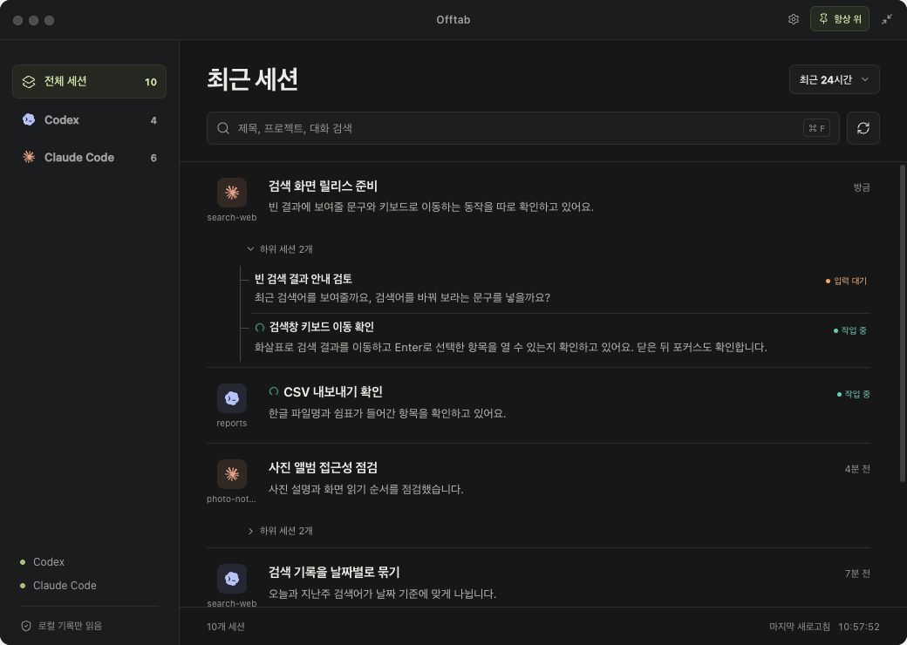

# Offtab

Codex와 Claude Code 채팅을 화면 한쪽에 띄워두는 Mac 앱입니다. 어떤 작업이 끝났는지, 어디에 내 답이나 승인이 필요한지 보고 목록에서 원래 채팅을 열 수 있습니다.

**[Mac용 DMG 다운로드][dmg]** · [앱 소개][site] · [릴리스 정보][release] · [문제 제보][issues]

Apple Silicon Mac · macOS 14 이상 권장 · v0.5.3 프리뷰

## 설치

1. [Offtab DMG][dmg]를 열고 **Offtab**을 **응용 프로그램** 폴더로 옮깁니다.
2. Offtab을 열고 Codex 또는 Claude Code에서 작업을 시작합니다. Offtab이 이 Mac에 있는 세션 기록을 읽어 목록을 채웁니다.

기존 Session Desk를 쓰고 있다면 이전 앱을 종료한 뒤 Offtab을 열면 됩니다. 창 배치, 읽음·제외 상태와 연결 설정을 이어서 사용합니다.

## 사용 방법

### 작은 창에서 진행 상황 보기

핀을 켜서 다른 창 위에 띄워두세요. 입력이나 승인이 필요한 채팅은 위로 올라옵니다. 백그라운드에서 끝난 작업도 결과를 읽을 때까지 남고, 읽은 뒤 한 시간 동안 새 작업이 없으면 작은 창에서 빠집니다.

채팅을 누르면 Codex나 Claude Desktop에서 원래 대화가 열립니다. 지원되는 Terminal·iTerm2 세션은 실행 중인 원래 탭으로 이동합니다. 한동안 숨길 채팅은 우클릭해 **목록에서 제외**를 선택하세요. 직접 새 메시지를 보내면 다시 표시됩니다. [최소화 화면 보기](docs/assets/offtab-compact.webp)

### 전체 창에서 지난 채팅 찾기

전체 창에서 최근 24시간이나 7일의 기록을 볼 수 있습니다. 제목, 작업 폴더, 최신 메시지로 검색하세요. 작은 창과 전체 창은 크기와 위치를 각각 기억합니다.

Claude Desktop에서 별도로 시작한 하위 세션은 두 화면 모두에서 부모 채팅 아래에 표시됩니다. 작은 창에서는 하위 세션의 제목과 상태, 최근 메시지를 최대 세 줄까지 볼 수 있습니다.



*예시 채팅 10개로 찍은 화면입니다.*

## 문제 해결

### Mac에서 Offtab이 열리지 않아요

v0.5.3 프리뷰는 아직 Apple 공증을 받지 않았습니다. 앱을 여는 과정에서 macOS 경고가 나오면 [Apple의 안내][apple]에서 표시된 메시지를 확인하세요. 설치 파일은 [이 저장소의 Releases][releases]에서 받을 수 있습니다.

### 입력이나 승인 대기가 바로 안 보여요

Offtab의 톱니바퀴 메뉴에서 **실시간 대기 감지**를 서비스별로 연결하세요. Codex는 연결 후 **설정 → 훅(Hooks)** 또는 CLI의 `/hooks`에서 훅 승인이 필요합니다. 연결한 뒤 새 세션을 열거나 기존 세션을 다시 열어 적용하세요. 같은 메뉴에서 macOS 알림도 켤 수 있습니다. [Codex 훅][codex-hooks] · [Claude Code 훅][claude-hooks]

### 터미널 탭이 열리지 않아요

원래 탭으로 처음 이동할 때 macOS가 Terminal 또는 iTerm2 자동화 권한을 요청할 수 있습니다. 이동할 탭은 실행 중이어야 합니다.

## 지원 범위와 데이터

이 Mac의 Codex와 Claude Code 세션을 지원합니다. 일반 Claude 웹 대화는 수집하지 않습니다. Offtab은 대화 기록을 Mac에서 읽고 외부 서버로 보내지 않습니다.

## 소스에서 실행

Node.js, rustup, Xcode Command Line Tools가 필요합니다. Rust 버전은 `rust-toolchain.toml`을 따릅니다.

```sh
npm ci
npm run check
node --test tests/compact-list.test.mjs
npm start
```

- 웹 데모는 `npm run demo`로 만든 뒤 `release/session-desk-demo.html`을 브라우저에서 엽니다.
- Apple Silicon DMG는 `npm run package:mac`으로 만듭니다. 결과물은 `src-tauri/target/aarch64-apple-darwin/release/bundle/dmg/`에 생성됩니다.
- 앱은 Tauri 2, Rust, React로 만들었습니다. 서비스 아이콘은 [Lobe Icons][lobe]에서 가져왔습니다. Codex와 Claude Code는 각 서비스의 제품명입니다.

[dmg]: https://github.com/bygjun/Agent-Offtab/releases/download/v0.5.3/Offtab-0.5.3-arm64.dmg
[release]: https://github.com/bygjun/Agent-Offtab/releases/tag/v0.5.3
[releases]: https://github.com/bygjun/Agent-Offtab/releases
[site]: https://bygjun.github.io/Agent-Offtab/
[issues]: https://github.com/bygjun/Agent-Offtab/issues/new
[apple]: https://support.apple.com/ko-kr/102445
[codex-hooks]: https://learn.chatgpt.com/docs/hooks
[claude-hooks]: https://code.claude.com/docs/en/hooks
[lobe]: https://github.com/lobehub/lobe-icons
